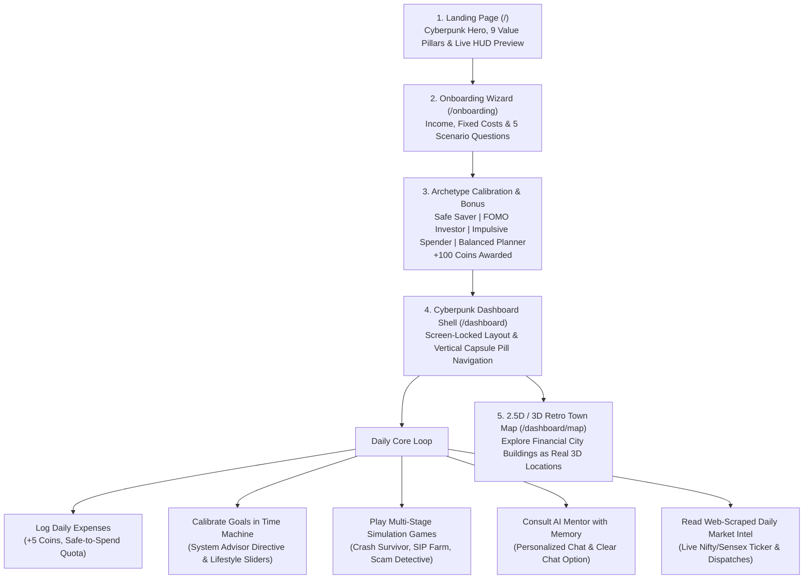

# PIXELMENTOR 🎮🪙🧙
### Cyberpunk Financial Engine & Autonomous AI Mentor for First-Time Earners in India

[](https://opensource.org/licenses/MIT)
[](https://fastapi.tiangolo.com)
[](https://react.dev)
[](https://vitejs.dev)
[](https://pytest.org)

> **EDUCATION-ONLY PLATFORM**: Pixel Mentor is built strictly for financial literacy. All projections are illustrative mathematical simulations, never regulated investment advice.

---

## 🌟 Overview

**PIXELMENTOR** transforms personal finance for young adults in India (college students, early-career professionals, and gig workers) into an **immersive cyberpunk retro RPG game**. 

Instead of dealing with confusing spreadsheets or intimidating banking interfaces, users navigate real-world financial dilemmas: weathering simulated market crashes, cultivating compounding farms, detecting financial fraud with forensic tools, analyzing real-time web-scraped market news, and consulting an autonomous AI coach with persistent memory.

---

## 🕹️ System Architecture & Workflow



---

## 📑 Complete Tab-by-Tab Breakdown

| Tab | Route | Primary Purpose & Feature Set |
| :--- | :--- | :--- |
| **Dashboard** | `/dashboard/overview` | **Mission Control & Live Hub**: Top metric HUDs (Income, Fixed Costs, Discretionary Pool, Savings Rate), Quick Expense Logger (+5 coins, daily cap 3), and the **Daily Investment Intel** box linked directly to the News desk. |
| **Budget** | `/dashboard/budget` | **Cashflow & Quotas**: 50/30/20 category tracking, category overspend alerts, and **Gig Worker Irregular Income Buffer** with dynamic `Safe to Spend Today` daily allowances. |
| **Goals** | `/dashboard/goals` | **Time Machine & System Advisor**: Interactive compounding sliders, lifestyle sacrifice toggles (food delivery/lunch cuts), and the **System Advisor Action Directive Box** that provides personality-calibrated advice with 1-click optimal pacing calibration. |
| **AI Coach** | `/dashboard/coach` | **Autonomous AI Mentor**: Conversational dialogue with Indian gaming metaphors, memory summaries, contextual profile awareness, Dashboard Q&A walkthrough (+25 coins), and a **Clear Chat** memory purge button. |
| **Games** | `/dashboard/games` | **Multi-Stage Simulation Arena**: 5 deep interactive scenarios: *Crash Survivor* (4-phase crisis timeline), *SIP Farm* (10-season compounding farm), *Scam Detective* (forensic cyber desk), *Budget Bazaar* (4-week cashflow survival), and *Inflation Island* (15-year time machine). Includes Mistake Replays and comparison curves. |
| **Learn** | `/dashboard/learn` | **ELI15 Jargon Busters**: 30 Indian financial terms explained with retro gaming analogies, in-text tooltips across the platform, and bite-sized quizzes with coin rewards. |
| **Scam Shield** | `/dashboard/scam` | **Zero-Trust Fraud Scanner**: Regex-powered rule engine analyzing suspicious messages for red flags (guaranteed returns, artificial urgency, fake SEBI licenses, VIP Telegram rooms). |
| **News** | `/dashboard/news` | **Live Web-Scraped Market Desk**: Live index ticker (NIFTY 50, SENSEX, Gold, USD/INR, Repo Rate), real-time financial RSS aggregation, sentiment classifications (`BULLISH`, `CAUTIOUS`, `WATCH`, `NEUTRAL`), and category filters. |
| **Town Map** | `/dashboard/map` | **2.5D / 3D Retro Game World**: Interactive city where buildings map to real modules. Features mobile touch D-pad, dynamic camera tracking, zoom controls, and proximity entrance cues. |
| **Help** | `/dashboard/help` | **Design System & Styleguide**: Specification of the 6-colour cyberpunk palette, 4 mentor mood avatars, typography, and reusable UI components. Includes top `< Back` navigation. |

---

## 🛠️ Tech Stack

### Frontend (`/web`)
* **Framework**: React 18 + Vite 5 + React Router v6
* **State Management**: Zustand (Global profile, coin economy, and real-time ledger updates)
* **Data Visualization**: Recharts (Compounding curves, area charts, budget donuts)
* **Icons & Styling**: Lucide React + Cyberpunk Glassmorphism CSS (`backdrop-filter`, scanlines, neon glows)

### Backend (`/api`)
* **Framework**: FastAPI (Python 3.10+) + Uvicorn
* **Database & ORM**: SQLAlchemy 2.0 + SQLite (with PostgreSQL compatibility)
* **Intelligence & Guardrails**: LLM integration with strict financial guardrails blocking individual stock/crypto ticker recommendations
* **Scraping Engine**: Standard-library XML/HTTP parser for financial RSS feeds with cache layer
* **Testing**: Automated Pytest suite with 31 unit and integration tests

---

## ⚙️ Environment Configuration (`.env`)

Create a `.env` file in the project root based on [`.env.example`](file:///c:/Users/nites/Desktop/invest/.env.example):

```env
# LLM Configuration (Groq / Grok / Gemini / OpenAI compatible)
LLM_API_KEY=your_api_key_here
LLM_MODEL=qwen/qwen3.8-27b
MOCK_LLM=false

# Backend Configuration
DATABASE_URL=sqlite:///./pixel_mentor.db
PORT=8000
HOST=0.0.0.0

# Frontend Configuration
VITE_API_URL=http://localhost:8000
```

### Key Reference:
* `LLM_API_KEY`: API key for your AI provider.
* `MOCK_LLM`: Set to `true` to run completely offline without external API dependencies.
* `DATABASE_URL`: Relational database connection string.
* `VITE_API_URL`: Points the frontend to the backend server.

---

## 🚀 Quickstart Guide

### 1. Prerequisites
* Python 3.10+
* Node.js 18+ & npm

### 2. Backend Setup
```bash
# Install Python dependencies
pip install -r api/requirements.txt

# Start FastAPI server
python -m uvicorn main:app --app-dir api --port 8000 --reload
```
* **API Health Check**: `http://localhost:8000/health` $\rightarrow$ `{"status": "ok"}`
* **Interactive Swagger Docs**: `http://localhost:8000/docs`

### 3. Frontend Setup
```bash
# Navigate to web directory and install packages
cd web
npm install

# Start Vite dev server
npm run dev
```
* **Landing Page**: `http://localhost:5173/`
* **Instant Demo Mode**: `http://localhost:5173/?demo=1` (pre-loads sample student profile and coins)
* **Dashboard**: `http://localhost:5173/dashboard`

---

## 🧪 Testing & Verification

### Automated Pytest Suite (31 Tests Passing)
Run the complete backend test suite:
```bash
python -m pytest api/tests -v -p no:anyio
```

### Production Build Verification
Ensure the frontend builds cleanly without errors:
```bash
cd web
npm run build
```

---

## 📄 License
This project is licensed under the [MIT License](LICENSE).
